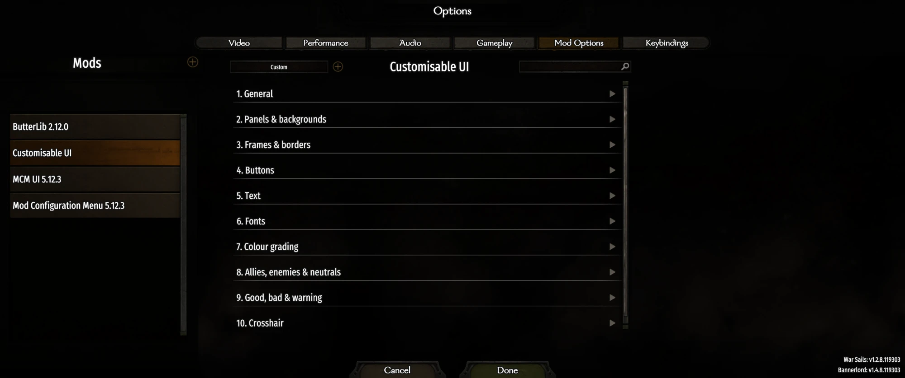
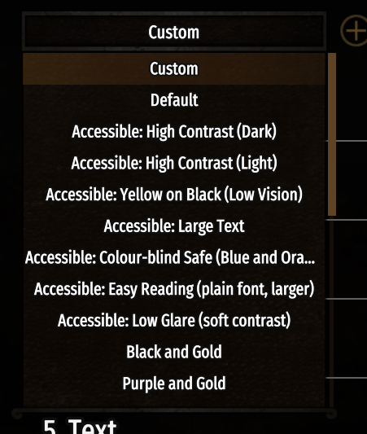
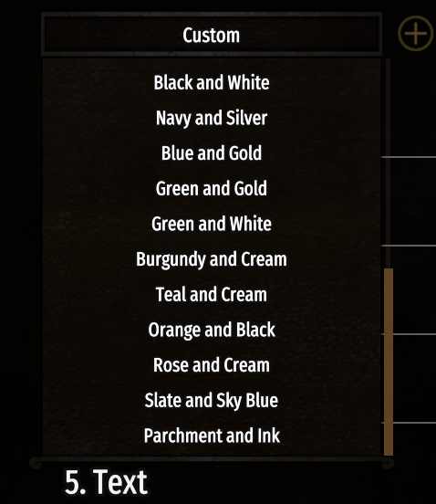
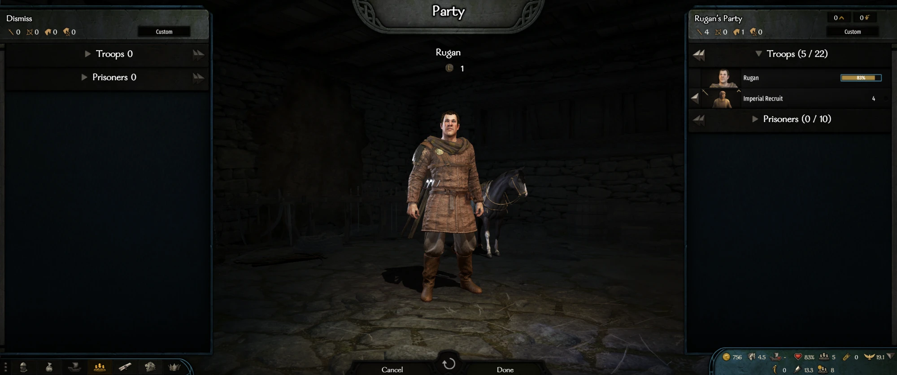
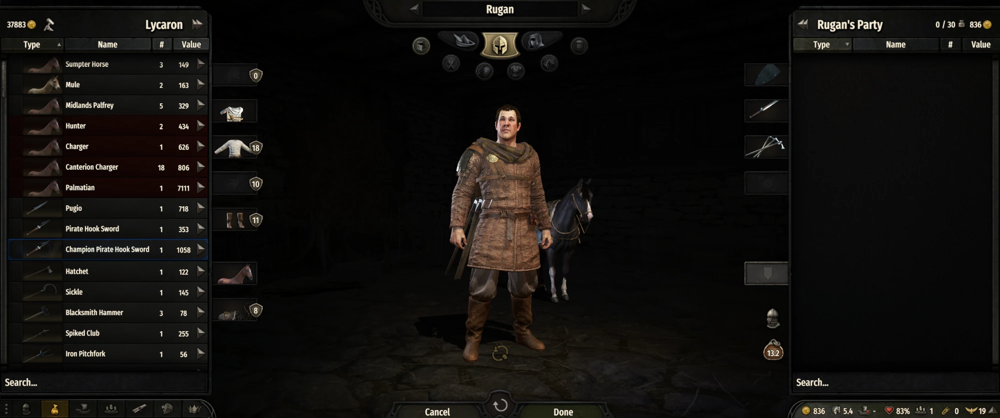
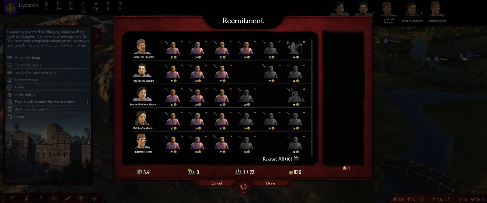
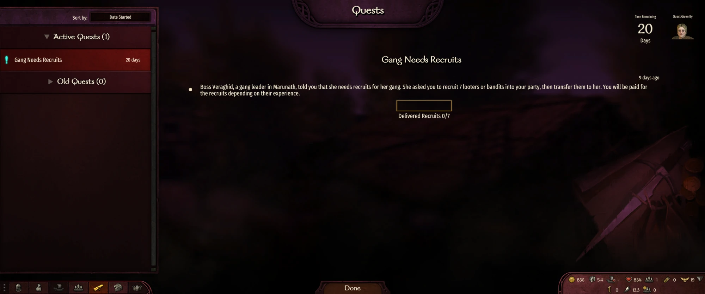
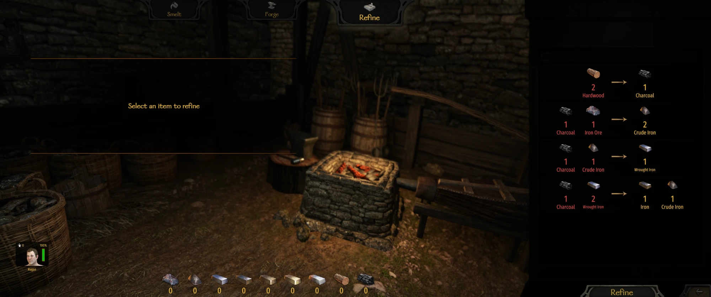
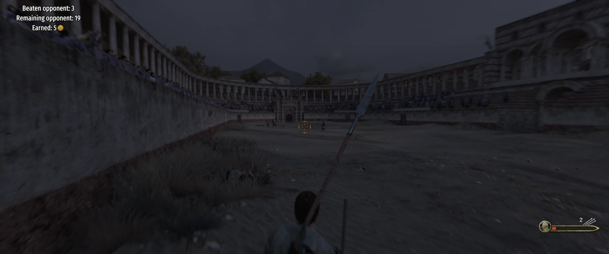

# Customisable UI

A Mount & Blade II: Bannerlord mod that lets you restyle the game's interface from an
[MCM](https://www.nexusmods.com/mountandblade2bannerlord/mods/612) settings screen. Changes apply live, including on
the settings screen itself, and nothing is stored in save games, so the mod can be added or removed at any time.

Built against Bannerlord **v1.4.8**. Requires [Harmony](https://www.nexusmods.com/mountandblade2bannerlord/mods/2006)
and [MCM v5](https://www.nexusmods.com/mountandblade2bannerlord/mods/612) (which itself needs ButterLib and UIExtenderEx).

## Screenshots

In-game screenshots with the mod installed.



The preset list: the accessibility presets come first, then 15 colour pairs.

<p>
  
  
</p>













## What it does

- **Recolours the interface.** Panels and backgrounds, frames and borders, and buttons and controls each get a colour
  (a named swatch or any `#RRGGBB`), a strength and a brightness; panels also get an opacity.
- **Colour grading.** Hue shift, saturation and brightness across all of the above, optionally including icons and artwork.
- **Text.** Recolour all text (or let the mod pick light or dark to suit your panels), add an outline or a soft shadow,
  adjust brightness, and keep text readable against your colours using the WCAG contrast standard.
- **Fonts and size.** Pick the main and decorative fonts from the game's own typefaces, and scale text from 75% to 135%.
- **Ally, enemy and neutral colours.** One colour for each, applied to settlement bars, party names and troop counts on the
  campaign map, party tooltips and battle markers.
- **Good, bad and warning colours.** One palette for gains, losses and warnings, including a colour-blind-safe option.
- **Crosshair.** Colour of the crosshair, its blocked state, the hit marker and the kill/headshot marker, plus opacity.
- **Presets.** One-click themes: 15 colour pairs (Black and Gold, Purple and Gold, Red and White...) and 7 accessibility
  presets (high contrast, low vision, large text, colour-blind safe, easy reading, low glare).
- **Accessibility.** WCAG contrast targets (3:1, 4.5:1, 7:1), colour-blind-safe status colours, large-text and
  low-vision presets, and a hotkey that drops back to the vanilla look from anywhere.
- **Compatibility.** An option that leaves colours added by other mods (item rows tinted by quality, say) alone, and a
  rules file for correcting anything the mod misjudges.
- **Safe by design.** Translucent screen-dimming layers (pause, autosave) keep their vanilla look; icons, bars, banners
  and scrollbars are never recoloured; every hook fails on its own without taking the UI down.

## Using it

Enable **Harmony**, **ButterLib**, **UIExtenderEx**, **Mod Configuration Menu v5** and **Customisable UI** in the
launcher, then open *Options -> Mod Options -> Customisable UI*. The preset dropdown at the top of the page sets
everything in one click; fine-tune afterwards with the options below. Everything starts on *Vanilla*, so installing the
mod changes nothing until you choose something.

**Hotkey.** `Ctrl+Shift+U` (changeable to F8, F9 or F10, or off) switches between your theme and the vanilla look, from
anywhere, including the settings screen. It is the way out of a combination that has made the interface hard to read, and
a quick way to compare. Press it again to bring your theme back. The settings themselves are untouched.

## The settings screen

62 options in 10 groups.

| Group | Options |
| --- | --- |
| 1. General | Master switch; write a debug log; *Keep colours added by other mods*; hotkey. |
| 2. Panels & backgrounds | Colour, custom hex, strength, brightness, opacity. |
| 3. Frames & borders | Colour, custom hex, strength, brightness. |
| 4. Buttons | Colour, custom hex, strength, brightness. Covers buttons, dropdowns, slider tracks and knobs, checkboxes and list entries. |
| 5. Text | Colour (or *Auto*), custom hex, strength; *Keep text readable* and its minimum contrast; brightness; outline colour and thickness; shadow strength and colour. |
| 6. Fonts | Main font, decorative font, text size. |
| 7. Colour grading | Hue shift, saturation, brightness; also grade icons and artwork. |
| 8. Allies, enemies & neutrals | An ally, enemy and neutral colour; which parts of the UI use them. |
| 9. Good, bad & warning | The colour-blind-safe palette; a good, bad and warning colour. |
| 10. Crosshair | Crosshair, blocked, hit marker and kill/headshot marker colours; opacity. |

Every colour option is a dropdown of 27 named swatches (including the Okabe-Ito colour-blind-safe set) plus *Custom*, which
reads the hex code in the box beneath it. A half-typed code is ignored, so the previous colour stays until it is valid.

## Presets

The preset dropdown at the top of the page. Presets set everything they mention and leave the rest at its default.

**Colour themes:** Black and Gold, Purple and Gold, Red and White, Black and Red, Black and White, Navy and Silver, Blue and
Gold, Green and Gold, Green and White, Burgundy and Cream, Teal and Cream, Orange and Black, Rose and Cream, Slate and Sky
Blue, Parchment and Ink. Treat them as starting points: colours are tints on the game's dark artwork, so the brightness
values were chosen by calculation rather than by eye.

**Accessible: ...** (listed first):

| Preset | For |
| --- | --- |
| High Contrast (Dark) | Maximum contrast: white on black, white frames, a heavy black text outline. 7:1. |
| High Contrast (Light) | The same idea inverted, for people who find light-on-dark hard to read: dark text on white. 7:1. |
| Yellow on Black (Low Vision) | Yellow on black, a classic low-vision combination, with 120% text, an outline and a yellow crosshair. 7:1. |
| Large Text | 130% text size in white on charcoal, with an outline. 7:1. |
| Colour-blind Safe (Blue and Orange) | Blue and orange chrome; red/green status text swapped for orange/blue; sky blue / vermillion / grey for ally / enemy / neutral; vermillion blocked and kill markers. 7:1. |
| Easy Reading | The game's plainest sans-serif in its heaviest weight in place of the decorative serif, 115% size, soft off-white on charcoal. 7:1. |
| Low Glare | For light sensitivity: muted charcoal and slate, no pure white, slightly dimmed text. 4.5:1. |

Every preset is checked against its own contrast target by the test suite, so a preset can't ship with unreadable text.

## How the colours work

**Tints, not paint.** Panels and frames in Bannerlord are brown artwork, not flat colour, so a colour is a **tint
multiplied with the artwork**: a dark tint gives a dark result, and the brightness slider compensates. Flat-colour fills
(most large window backgrounds and tooltips) are the exception: they take a toned-down version of the chosen colour, keep
their own transparency, and respond less strongly to the brightness slider.

**Readable text.** With *Keep text readable* on (the default) the mod estimates how light or dark your panel and button
colours will look and, if the chosen text colour (or vanilla text) would be hard to read on them, uses light or dark text
instead. *Text colour: Auto* always picks for you. The estimate uses the WCAG contrast ratio, held to *Minimum text
contrast*: 3:1, 4.5:1 (WCAG AA, the default) or 7:1 (AAA).

**Text shadow.** A soft dark halo behind text, which helps names stay readable over a busy map. It uses the game's own
text-shader glow, so it is a halo with a slight downward nudge rather than a hard drop shadow.

**Good, bad and warning.** The game marks gains, losses and warnings with named styles ("Positive", "Bonus", "Negative",
"Penalty", "Warning"), and draws a lot of other text simply in strong red or green. Pick a colour for each and the mod
applies it to both, plus the inventory and party transfer slider fills and the crafting slider. *Red and green status
palette: Colour-blind safe* supplies orange and blue (Okabe-Ito, light variants on dark panels and deeper ones on light
panels); any colour you pick explicitly wins over it. Health bars and other graphics that merely look red or green are
not touched.

**Crosshair.** The six crosshair line brushes are white and turn red in an "Invalid" state; the hit marker flashes white
and, on a kill, red; the headshot marker is red. Each of those four has its own colour here, independent of the others,
and one opacity slider covers them all. Crosshair *size* is set by the game's layout and isn't adjustable.

**Ally, enemy and neutral.** The relation is the game's own: at war with your faction (bandits included) is an enemy; your
own faction or an alliance is an ally; everyone else is neutral. Each part has its own switch:

| Setting | What changes |
| --- | --- |
| Colour settlement bars on the map | The coloured bar behind each castle, town and village name (the game uses dark green, dark red and black). Toned down like other flat fills so white names stay readable. |
| Colour parties and settlements on the map | Party names, speeds and troop counts on the campaign map. The game already colours these by relation (green for your faction, red for enemies, pale for neutrals, blue for alliances, lighter for armies); the mod recognises those colours and swaps in yours, so it follows the game's own idea of who is an ally. A colour under *Text* won't override them. Your own party keeps its colour. |
| Colour party tooltip troop counts | The ally, enemy and neutral troop numbers in party tooltips. |
| Colour battle markers | Formation markers, siege engine markers, and friendly/enemy name text in battle. Your own formation's marker keeps its colour. |

**Not covered:** the 3D party models and banners on the map, minimaps, and anything else the game draws outside its UI
(such as the outlines around characters). The engine renders those, so this mod can't reach them.

## Compatibility

**Mods that colour the UI.** Some mods colour parts of the interface to mean something, for example item rows tinted by
quality or rarity. Theming those rows would replace the colour the other mod chose, so **Keep colours added by other
mods** (General) leaves anything already in a clearly coloured shade alone: panels, buttons and text that are not black,
white, grey or the game's usual muted browns and creams. It is **off by default**, because it is a blunt test: it also
leaves a few of the game's own coloured elements unthemed (green and gold buttons, damage flashes, some dark-blue menu
buttons), and gold title text keeps its gold instead of following a colour set under *Text*. Red/green status text is
handled by its own settings regardless.

**`UiRoles.txt`.** The mod decides what is a panel, frame or button from the brush and sprite names the game draws with,
and is deliberately cautious. If something is misjudged, add a rule to `Module/UiRoles.txt` (next to `SubModule.xml`; no
rebuild needed), for example `brush:Inventory.ItemTuple = panel` or `brush:HealthBar = other`. Turn on *Write a debug log*
to see every brush and sprite the mod meets and what it decided, in
`Documents\Mount and Blade II Bannerlord\Logs\CustomisableUI.log`. Items kept by the colour option are marked
`(kept: coloured)`.

**Screen dimming is left alone.** The translucent full-screen layers the game draws while paused, saving or loading keep
their vanilla look; only opaque full-screen backgrounds and ordinary panels are themed.

## How it works

Gauntlet (the game's UI) draws everything through a few chokepoints, and the mod hooks those with Harmony at the last
moment before something is drawn. Each hook is applied separately and fails on its own, so one changed game method
disables only its own feature.

| Hook | Used for |
| --- | --- |
| `BrushRenderer.Render` | Notes which brush, and which style of it, is being drawn. |
| `Widget.OnRender` | Notes that a widget is drawing its own attached sprite (headers, window backgrounds, dividers). |
| `TwoDimensionDrawContext.DrawSprite` | Recolours and grades sprites, once the brush, style and sprite names are known. |
| `BrushRenderer.CreateTextMaterial`, `Style.CreateTextMaterial` | Recolours, outlines and shadows plain and rich text. |
| `FontFactory.GetMappedFontForLocalization` | Swaps fonts (only when the language uses the stock Latin fonts). |
| `Text.FontSize` setter | Scales text. |
| `OnApplicationTick` | Polls the hotkey. |

**Deciding what is a panel.** Gauntlet has no "this is a panel" flag, so `RoleClassifier` decides from names
(`...Background`, `...Frame`, `...Button` follow consistent conventions in the base game). It is conservative: icons,
banners, scrollbars, health and progress bars, glows, dividers and anything unrecognised stay vanilla, because a wrongly
tinted bar changes its meaning.

**Two ways the game draws a sprite.** Most UI goes through a *brush* (a named set of sprite layers), but prefabs also
attach a sprite straight to a plain widget, which is how many window backgrounds and header bars are drawn. Those have no
brush name, so they are classified from the sprite name plus a size check: a large flat rectangle or stretchable sprite
with no artwork-like name counts as a panel background.

**Why only those two paths.** The game reuses draw materials from a pool without resetting them, so a change is only safe
where the caller re-sets every field the mod adjusts on its next use. `BrushRenderer.Render` and `Widget.OnRender` both do;
other sprite draw paths do not, and styling there would compound every frame.

**Relation colours** are read back from colours the game already draws with (the party nameplate colours in
`PartyNameplateVM`, the settlement bar and formation marker colours in the brush files) rather than computed from campaign
state, which keeps the mod out of the game's nameplate classes.

**Crash diagnostics.** If a text lookup fails or anything crashes unhandled, the full call stack is written to
`CustomisableUI.log`, which says whether the mod, another mod or the game is responsible.

## Known limits

- **Fonts are the stock ones.** Gauntlet fonts are pre-baked signed-distance-field atlases, not live TrueType, so the
  dropdowns offer the game's own fonts (Fira Sans Extra Condensed in three weights, and Galahad). Adding a typeface means
  generating an atlas with the Modding Kit's `TaleWorlds.GauntletUI.FontAtlas.exe` and registering it; see
  `GUI/GauntletUI/Fonts/GenerateFont.bat` in the game folder. Not done yet.
- **Text size** scales labels and most single-line text; long rich-text passages (conversations, the encyclopedia) keep
  their vanilla size, and fixed-size labels can clip at the largest sizes.
- Non-Latin languages keep their own fonts, since the Latin fonts have no glyphs for them.
- **Crosshair size** and the shape of its markers come from the game's layout and sprites and aren't adjustable.
- The mod is untested on the Xbox/Game Pass build (the zip includes its binaries) and with War Sails disabled.

## Development

### Layout

```
CustomisableUI.sln
src/CustomisableUI/           C# project (the DLL)
  CustomisableUI.csproj       Version number, game install path, build/deploy/package steps
  SubModule.cs                Entry point: applies each Harmony patch class, hotkey tick, loads UiRoles.txt
  ModSettings.cs              The MCM screen and its presets
  ThemeSnapshot.cs            The settings resolved into plain values for the draw hooks
  ThemeState.cs               Keeps that snapshot fresh (re-read ten times a second); the hotkey's suspend switch
  Patches.cs                  The Harmony hooks (draw path, text, fonts, text size) and the debug recorder
  Stylers.cs                  Applies a theme to a sprite or text material; good/bad/warning classification
  SemanticStyler.cs           Crosshair and gain/loss slider-fill sprites
  RelationStyler.cs           Sprites and text the game colours by relation
  Relation.cs                 Ally / enemy / neutral, read back from the colours the game already draws with
  RoleClassifier.cs           Panel / frame / button / other decision, plus UiRoles.txt overrides
  Contrast.cs                 WCAG contrast maths: light/dark text choice and the readability rule
  Swatches.cs                 Named colours, hex parsing and formatting
  Hotkey.cs                   The vanilla-look toggle
  CrashDiagnostics.cs         Full call stack for a failing text lookup or an unhandled exception
  Log.cs                      Logging
tests/CustomisableUI.Tests/   Checks that run against the real game assemblies (see Testing)
Module/                       Non-code module files, copied as-is into the module folder
  SubModule.xml               Module manifest ($version$ and $gameversion$ are filled in at build time)
  UiRoles.txt                 User-editable role overrides
nexus/description.bbcode.txt  Text for the Nexus mod page
docs/screenshots/             Screenshots shown in this README
CHANGELOG.md                  What changed in each version
artifacts/                    Build output (git-ignored)
releases/                     The Nexus upload for each released version, copied from artifacts/ and committed
```

### Building

Needs the .NET SDK (any recent version). The project compiles against the DLLs in your game install, and defaults to
`C:\Program Files (x86)\Steam\steamapps\common\Mount & Blade II Bannerlord`. To use a different install, set the
`BANNERLORD_GAME_DIR` environment variable or pass `-p:GameFolder="..."`.

```powershell
dotnet build src/CustomisableUI/CustomisableUI.csproj -c Debug
```

Builds the DLL, assembles the module in `artifacts/Debug/CustomisableUI/` and copies it into
`<game>/Modules/CustomisableUI/`. Add `-p:DeployToGame=false` to skip that copy.

```powershell
dotnet build src/CustomisableUI/CustomisableUI.csproj -c Release
```

Does the same and also writes the Nexus upload, `artifacts/CustomisableUI-v<version>.zip`, containing binaries for both the
Steam/GOG/Epic build and the Xbox/Game Pass build.

### Testing

```powershell
dotnet run --project tests/CustomisableUI.Tests -c Release
```

Compiles the mod's own source into a test program and runs about 270 checks against your real game install, without
launching the game or deploying anything. The exit code is the number of failures. They cover:

- colour swatches and hex handling, including a round trip through the game's own colour parser;
- contrast maths, and every preset against its own contrast target;
- the settings screen as MCM sees it (every option present, defaults changing nothing);
- the panel / frame / button decision against known real brush and sprite names, and `UiRoles.txt` rules;
- panel, text, outline and shadow styling; good / bad / warning; crosshair; ally / enemy / neutral (read against the
  game's own `PartyNameplateVM` colours); keeping other mods' colours; screen dimming;
- every brush in the game's own files, for invariants that must always hold (bars and scrollbars stay vanilla);
- every Harmony hook binding to the real game method.

What it can't check is how things look: that needs the game running.

### Releasing on Nexus Mods

1. Bump `<Version>` in `src/CustomisableUI/CustomisableUI.csproj`. It is the only place the version lives.
2. Run the tests, then `dotnet build src/CustomisableUI/CustomisableUI.csproj -c Release`.
3. Upload `artifacts/CustomisableUI-v<version>.zip` as the main file, with the same version number. Copy it into
   `releases/` and commit it, so the exact file that was uploaded is kept with the source it was built from.
4. Under Requirements, add **Harmony** (mod 2006) and **MCM** (mod 612). Paste `nexus/description.bbcode.txt` into the
   description.
5. After the first upload, set `<Url>` in `Module/SubModule.xml` to the mod page and `<UpdateInfo>` to
   `NexusMods:<mod id>`.

### Updating for a new game version

Set `<GameVersion>` in `CustomisableUI.csproj`, rebuild and run the tests: the hook checks and the checks against the
game's own data show what changed. Any hook that fails to bind is also logged to `CustomisableUI.log`.

## License

[MIT](LICENSE): free to use, modify and redistribute, including in your own mods. The code was written with the help of AI
tools, and you are welcome to change it however you like.
